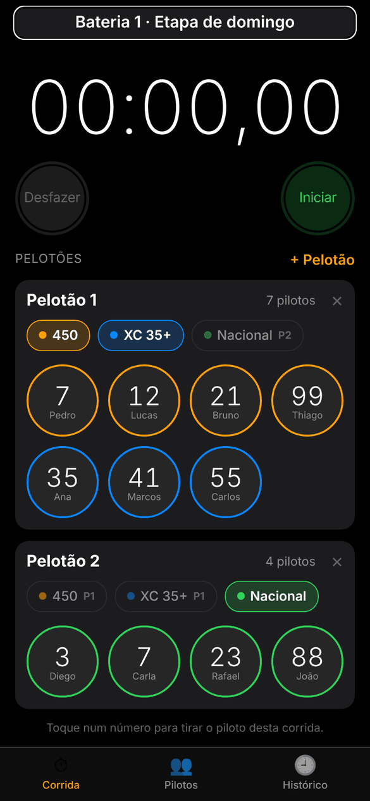
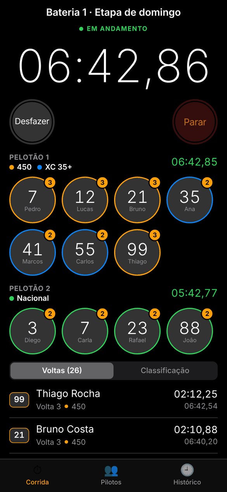
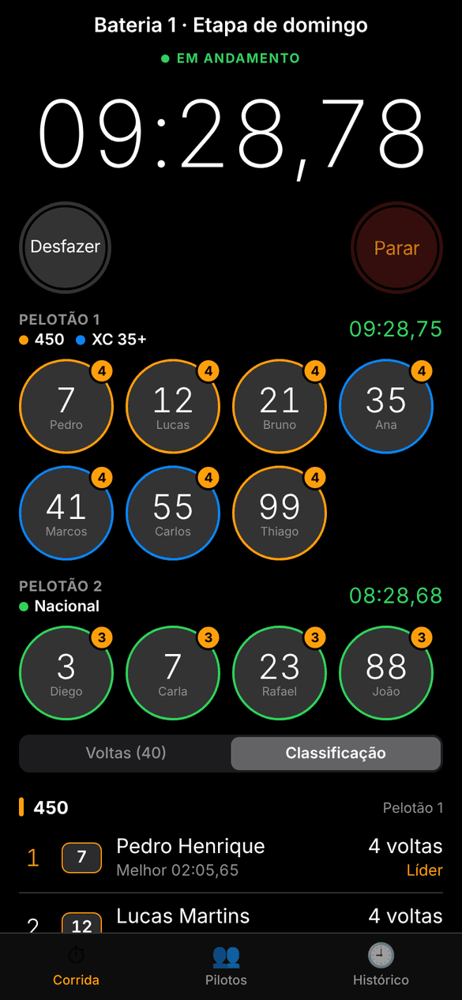
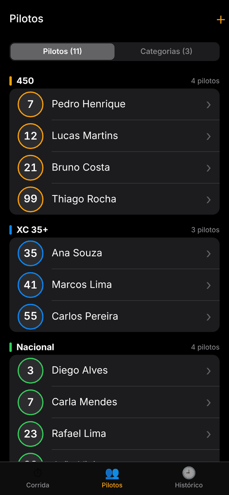
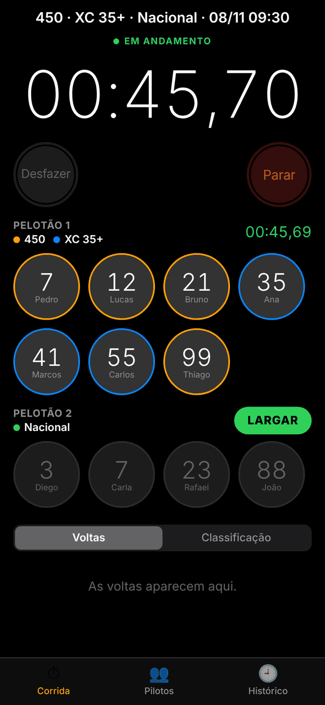
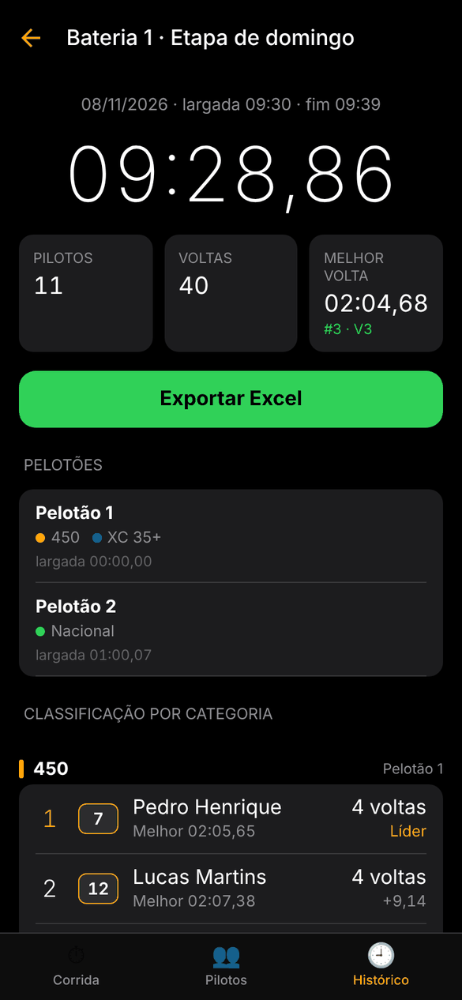
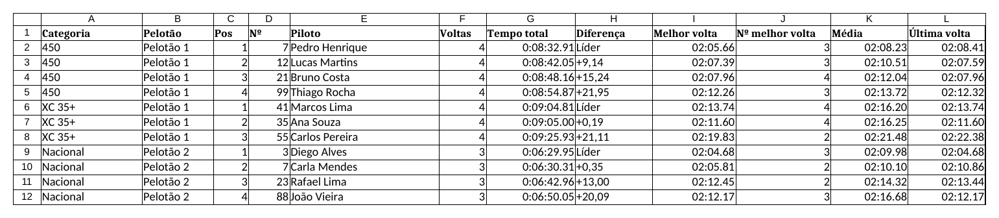

# Corridas

Aplicativo mobile para **cronometrar corridas com largada por pelotão**: motocross, velocross, enduro, kart ou qualquer prova em circuito com várias categorias na pista ao mesmo tempo.

Você cadastra os pilotos por categoria, monta os pelotões, larga um pelotão depois do outro e marca cada volta tocando no número do piloto. O app calcula o tempo de cada volta, monta a classificação de cada categoria ao vivo, guarda o histórico e exporta tudo para Excel. Funciona offline, e os dados ficam salvos no próprio celular.

<p align="center">
  
  
  
</p>

---

## Funcionalidades

- **Visual de cronômetro do iPhone**: display grande e botões redondos (Iniciar, Parar, Retomar, Desfazer, Finalizar), em tema escuro.
- **Categorias**, como 450, XC 35+ ou Nacional, cada uma com uma cor. O mesmo número de piloto pode existir em categorias diferentes.
- **Pelotões**: você define quais categorias largam juntas e larga cada pelotão quando quiser. Cada pelotão tem seu próprio cronômetro.
- **Uma volta, um toque**: tocar no número do piloto registra a volta, com vibração. O botão Desfazer apaga a última, e segurar uma volta na lista exclui ela.
- **Classificação ao vivo por categoria**, com diferença para o líder (em tempo ou em voltas). A volta mais rápida aparece em verde e a mais lenta em vermelho.
- **Histórico** de corridas, com o detalhe volta a volta de cada piloto.
- **Exportação para Excel (.xlsx)**, para compartilhar (WhatsApp, e-mail, Drive) ou salvar numa pasta do celular.
- **Tudo offline e local**: uma corrida em andamento continua de onde parou mesmo se o app for fechado, e a tela não apaga durante a prova.

## Como funciona

### 1. Categorias e pilotos

Na aba **Pilotos**, a parte **Categorias** serve para criar, renomear e excluir categorias. Cada piloto tem número, nome e uma categoria, que também pode ser criada direto no cadastro do piloto.

O número precisa ser único **dentro da categoria**: dá para ter o #7 na 450 e o #7 na Nacional.

<p align="center">
  
</p>

### 2. Montagem da largada

Na aba **Corrida**, antes de iniciar, você monta os pelotões. Toque em **+ Pelotão** e nas categorias que largam em cada um, por exemplo:

| Pelotão | Categorias |
|---|---|
| Pelotão 1 | 450 + XC 35+ |
| Pelotão 2 | Nacional |

Os números de cada pelotão aparecem logo abaixo dele. Tocar num número tira o piloto daquela corrida. Essa montagem fica salva para a próxima bateria.

### 3. Largada e marcação das voltas

**Iniciar** começa o relógio geral e larga o **Pelotão 1**. Os outros pelotões ficam com os números apagados e um botão **LARGAR**, que você toca na hora em que eles saem. Se tocar por engano, basta segurar o título do pelotão para cancelar a largada, desde que ninguém dele tenha marcado volta.

Durante a prova, os números ficam divididos por pelotão. Cada toque registra uma passagem pela linha, e o contador laranja no número mostra quantas voltas o piloto já fez.

<p align="center">
  
</p>

### 4. Como os tempos são calculados

Tudo é calculado a partir de marcações de tempo (timestamps), sem depender de um timer rodando. Por isso o tempo continua certo se o app for fechado e aberto de novo.

- **Relógio geral**: `tempoAcumulado + (agora − retomadoEm)`. Ele começa na largada do Pelotão 1 e pode ser pausado e retomado.
- **Largada de um pelotão**: grava o valor do relógio geral naquele instante (`startOffsetMs`).
- **Cada volta**: grava `t`, o relógio geral no momento do toque. O horário é capturado quando o dedo encosta na tela, não quando ele solta.
- **Tempo de prova do piloto**: `t − largada do pelotão dele`.
- **Tempo da volta**: diferença entre duas passagens seguidas. A primeira volta conta a partir da largada do pelotão.
- **Classificação** (separada por categoria): primeiro quem tem **mais voltas**; em caso de empate, quem tem o **menor tempo de prova na última passagem**.
- **Diferença**: para quem está na mesma volta do líder, é a diferença de tempo (`+1,23`); para quem está atrás, é o número de voltas (`+1 volta`).

### 5. Histórico e Excel

Ao **Finalizar**, a corrida vai para o histórico. Lá aparecem os pelotões com o horário de largada de cada um, a classificação por categoria e a lista de voltas de cada piloto.

<p align="center">
  
</p>

**Exportar Excel** gera um `.xlsx` com 4 abas. Os tempos são gravados como números de tempo do Excel (dá para somar, ordenar e fazer média), formatados como `mm:ss,cc`.

| Aba | Conteúdo |
|---|---|
| **Resumo** | Nome, data, duração, pelotões (categorias e largada) e o vencedor de cada categoria, com a melhor volta |
| **Classificação** | Categoria, pelotão, posição, número, piloto, voltas, tempo total, diferença, melhor volta, média e última volta |
| **Voltas** | Todas as passagens em ordem, com tempo da volta, tempo de prova e relógio da corrida |
| **Por piloto** | Tabela de voltas × pilotos, com melhor volta, média, total e posição |



### 6. Armazenamento local

Os dados são salvos com o AsyncStorage, em JSON, no próprio aparelho:

| Chave | O que guarda |
|---|---|
| `@corridas/v1/categories` | Categorias (nome e cor) |
| `@corridas/v1/pilots` | Pilotos (número, nome e categoria) |
| `@corridas/v1/setup` | Última montagem de pelotões |
| `@corridas/v1/current` | Corrida em andamento |
| `@corridas/v1/races` | Histórico de corridas finalizadas |

Cada corrida guarda uma **cópia dos pilotos** do momento em que foi disputada. Assim, editar ou excluir um piloto depois não altera o histórico. Dados de versões anteriores (sem categorias nem pelotões) são convertidos automaticamente ao abrir o app, em `normalizeRace` e no carregamento do `store`.

## Tecnologias

| | |
|---|---|
| Framework | [Expo](https://expo.dev) SDK 57 + React Native 0.86 (New Architecture, Hermes) |
| Linguagem | TypeScript |
| Navegação | Expo Router, com abas nativas e Stack |
| Persistência | `@react-native-async-storage/async-storage` |
| Excel | [SheetJS](https://sheetjs.com) (`xlsx`) |
| Arquivos e compartilhamento | `expo-file-system` (incluindo o seletor de pasta do Android) e `expo-sharing` |
| Outros | `expo-haptics` (vibração ao marcar volta) e `expo-keep-awake` (tela acesa durante a corrida) |

## Estrutura

```
src/
├── app/                      # telas (Expo Router)
│   ├── _layout.tsx           # tema, splash e abas
│   ├── index.tsx             # Corrida: cronômetro, pelotões, voltas e classificação
│   ├── pilotos/index.tsx     # Pilotos e Categorias
│   └── historico/
│       ├── index.tsx         # lista de corridas
│       └── [id].tsx          # detalhe da corrida + exportar Excel
├── components/
│   ├── PilotPad.tsx          # teclado de números dos pilotos
│   ├── RaceSetup.tsx         # montagem dos pelotões
│   ├── TimerText.tsx         # display grande do cronômetro
│   ├── GroupTimer.tsx        # cronômetro de cada pelotão
│   ├── RoundButton.tsx       # botões redondos estilo iPhone
│   ├── RaceLists.tsx         # linhas de volta e de classificação
│   ├── PilotFormModal.tsx / CategoryFormModal.tsx / FormSheet.tsx
│   └── app-tabs.tsx          # abas nativas (app-tabs.web.tsx na web)
├── lib/
│   ├── types.ts              # modelo de dados (Category, Pilot, Race, RaceGroup, Lap)
│   ├── race.ts               # regras de tempo, classificação e migração
│   ├── store.tsx             # estado global + persistência
│   ├── excel.ts              # geração do .xlsx e exportação
│   ├── storage.ts            # leitura e gravação no AsyncStorage
│   └── categories.ts, format.ts, dialog.ts, id.ts
└── constants/                # tema (cores), layout e versão
gerar-apk.ps1 / GERAR-APK.bat # build do APK no Windows
```

## Rodando o projeto

### Desenvolvimento

É preciso ter o [Node.js](https://nodejs.org) LTS instalado.

```bash
npm install
npx expo start          # abre no celular pelo Expo Go (SDK 57)
npx expo start --web    # versão web, útil para testar
```

```bash
npm run typecheck
npm run lint
```

### Gerar o APK (Windows)

Dê duplo clique em **`GERAR-APK.bat`**. O script compila o app no próprio PC, sem Expo Go, sem conta Expo e sem EAS:

1. Instala o JDK 17 pelo `winget` e o Android SDK (cmdline-tools, platform 36, build-tools, NDK e CMake) em `%LOCALAPPDATA%\Android\Sdk`, se ainda não estiverem instalados.
2. Copia o projeto para `C:\cbuild\corridas`, um caminho curto para não estourar o limite de 260 caracteres do Windows.
3. Roda `npm install`, `npx expo prebuild --platform android` e `gradlew assembleRelease` (arm64-v8a + armeabi-v7a).
4. Gera **`Corridas-v<versão>.apk`** na pasta do projeto.

A primeira execução baixa cerca de 4 GB e leva de 20 a 40 minutos. As seguintes levam poucos minutos. Instalar um APK novo por cima do anterior mantém os dados.

Também dá para gerar o APK na nuvem com o EAS, usando uma conta Expo:

```bash
npx eas-cli@latest build -p android --profile preview
```

## Versões

| Tag | O que mudou |
|---|---|
| `v1` | Primeira versão: pilotos, cronômetro estilo iPhone, voltas, histórico e Excel |
| `v2` | Migração para o Expo SDK 54 |
| `v3` | Expo SDK 57 e abas nativas |
| `v4` | Build de APK pelo EAS e opção "Salvar no celular" para o Excel |
| `v5` | APK gerado localmente no Windows (`GERAR-APK.bat`) |
| `v6` | Categorias, largada por pelotão e classificação por categoria |

Detalhes em [CHANGELOG.md](CHANGELOG.md).

> As capturas de tela são da versão web usada nos testes. No Android, a barra de abas é a nativa do sistema.

## Autor

**Pedro Thomas Hehn Beskow**
